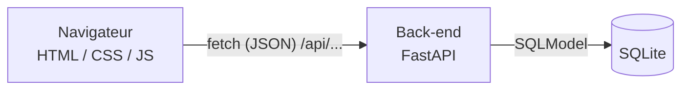

# 4a-isi-projet-front

Front-end de **Pol-eat-heck**, une application web permettant de créer des menus permanents à la semaine, avec un système de réservation.

Projet réalisé dans le cadre du TP 5 de 4A ISI.

## Dépôts du projet

| Partie | Dépôt | Technologies |
|---|---|---|
| Front-end (ce dépôt) | [4a-isi-projet-front](https://github.com/manouDK/4a-isi-projet-front) | HTML, CSS, JavaScript |
| Back-end (dépôt d'assemblage) | [4a-isi-projet-back](https://github.com/manouDK/4a-isi-projet-back) | Python, FastAPI, SQLModel |
| Base de données | [4a-isi-projet-db](https://github.com/manouDK/4a-isi-projet-db) | SQLite |

La documentation globale du projet (contrat d'interface `docs/API.md`, architecture, charte d'équipe `CONTRIBUTING.md`) sera centralisée dans le dépôt back.

## Fonctionnalités prévues

- **Visiteur** : consulter les produits et les menus, créer un compte (le mot de passe généré n'est affiché qu'une seule fois), se connecter.
- **Utilisateur connecté** : commander des produits ou des menus à l'avance, consulter ses commandes, changer son mot de passe.
- **Administrateur** : gérer les produits et leur stock, les menus et leur disponibilité, les jours de fermeture, et bloquer / débloquer des comptes.

Le paiement n'est pas géré dans l'application : il se fait au moment du retrait de la commande.

## Architecture globale



En production, le front sera intégré au dépôt back (submodule Git ou lien symbolique) et servi en statique par FastAPI, sur la même adresse que l'API. Les appels utilisent donc des chemins relatifs.

## Équipe

| Membre | GitHub | Rôle |
|---|---|---|
| Ahmad | [ahmaditani24](https://github.com/ahmaditani24) | Front-end (responsable de ce dépôt) |
| Manuella | [manouDK](https://github.com/manouDK) | Base de données, binôme d'intégration |
| Jephte | [jomojephte-star](https://github.com/jomojephte-star) | Back-end, binôme d'intégration |
| Enseignant | [esirem-chassel](https://github.com/esirem-chassel) | Collaborateur (suivi du projet) |

## Lancer le front en local

Pendant le développement, ouvrir le dossier dans VS Code et utiliser l'extension **Live Server** (bouton « Go Live »), ou lancer :

```bash
python -m http.server 5500
```

puis ouvrir `http://localhost:5500`.

Tant que les routes du back ne sont pas prêtes, le front utilise des données fictives conformes au contrat d'interface.

## Structure du dépôt

4a-isi-projet-front/
├── index.html           catalogue public (menus et produits)
├── css/
│   └── style.css        style commun à toutes les pages
├── js/
│   ├── api.js           seul fichier qui appelle le back (+ données fictives)
│   ├── auth.js          session : token, utilisateur connecté, rôle
│   └── pages/
│       └── index.js     affichage du catalogue
├── .gitattributes       fins de ligne LF
└── README.md
```

Chaque page `xxx.html` a son propre script `js/pages/xxx.js`. Les pages de connexion, de commande et d'administration seront ajoutées au fur et à mesure.
